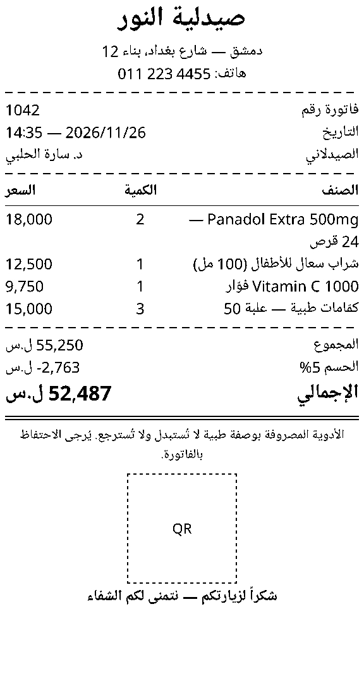

# escpos-arabic

**Arabic receipts that print correctly on ESC/POS thermal printers.**
Joined letters, right-to-left layout, Arabic and Latin in one line, columns that wrap, native QR codes and barcodes.

> إيصالات عربية تُطبع صحيحة على طابعات الإيصالات الحرارية: حروف متصلة، من اليمين إلى اليسار، عربي وإنجليزي في السطر نفسه، أعمدة، ورموز QR وباركود.

<p align="center"></p>

<sub>Preview generated by <code>examples/pharmacy.mjs</code> (fictional data). The QR code is printed by the printer itself, so the preview shows its frame.</sub>

## Why

Thermal printers print text one code page character at a time. Arabic does not survive that: letters come out in their isolated forms, words come out backwards, and a price inside a sentence lands in the wrong place. Code pages such as CP864 help only partly, and differ from printer to printer.

`escpos-arabic` lays the receipt out the way a browser would — [HarfBuzz](https://harfbuzz.github.io/) joins the letters, the [Unicode bidi algorithm](https://unicode.org/reports/tr9/) orders Arabic, numbers and Latin — and sends the result as a raster image (`GS v 0`), which every ESC/POS printer understands. QR codes, barcodes, paper feed, cutting and the cash drawer use the printer's own commands.

## Install

```bash
npm install escpos-arabic
```

Works in Node 20+ and in the browser (bundlers that support WebAssembly and top-level `await`). Two dependencies: [`harfbuzzjs`](https://github.com/harfbuzz/harfbuzzjs) and [`bidi-js`](https://github.com/lojjic/bidi-js).

## Quick start

```js
import { readFileSync } from 'node:fs'
import net from 'node:net'
import { createReceipt, ltr } from 'escpos-arabic'

const receipt = createReceipt({
  width: '80mm', // or '58mm'
  font: readFileSync('fonts/NotoNaskhArabic-Regular.ttf'),
  boldFont: readFileSync('fonts/NotoNaskhArabic-Bold.ttf'),
  fallbackFonts: [readFileSync('fonts/NotoSans-Regular.ttf')], // for Latin brand names
})

receipt
  .text('صيدلية النور', { size: 44, bold: true, align: 'center' })
  .text(`هاتف: ${ltr('011 223 4455')}`, { align: 'center' })
  .rule()
  .row(['الصنف', 'الكمية', 'السعر'], { widths: [3, 1, 1.6], bold: true })
  .row(['Panadol Extra 500mg', '2', '18,000'], { widths: [3, 1, 1.6] })
  .rule()
  .row(['الإجمالي', '18,000 ل.س'], { size: 32, bold: true })
  .qr('https://example.com/r/1042')
  .cut()

// Send to a network printer (raw port 9100)
const socket = net.connect(9100, '192.168.1.50', () => socket.end(receipt.encode()))
```

`encode()` returns a `Uint8Array`. Send it over whatever connects you to the printer: a TCP socket, [`usb`](https://www.npmjs.com/package/usb), WebUSB or Web Serial in the browser, a Bluetooth plugin in Capacitor or React Native, or a raw print job in Electron.

## Fonts

The library draws with the fonts you give it (TrueType or OpenType bytes; WOFF and WOFF2 are not supported). No font is bundled. Good open-licensed choices:

| Use | Fonts (SIL Open Font License) |
|---|---|
| Arabic | Noto Naskh Arabic, Noto Sans Arabic, IBM Plex Sans Arabic, Cairo |
| Latin fallback | Noto Sans, IBM Plex Sans |

Most Arabic fonts have no Latin letters, so pass a Latin font in `fallbackFonts`: every character is drawn with the first font that has it. Load a font once with `new TypeFace(bytes)` and reuse it across receipts.

## Numbers and mixed text

Text is ordered by the Unicode bidi algorithm, as in a browser. Two things follow from it:

- A number on its own, or after Arabic words, keeps its digit order: `المجموع 55,250`.
- Several numbers separated by spaces, or a leading minus, are ordered right to left like the words around them. Wrap anything that must stay exactly as typed in `ltr()`:

```js
receipt.text(`هاتف: ${ltr('011 223 4455')}`)
receipt.row(['الحسم', `${ltr('-2,763')} ل.س`])
```

`digits: 'arabic'` prints 0–9 as ٠–٩.

## API

### `createReceipt(options)` / `new Receipt(options)`

| Option | Default | |
|---|---|---|
| `font` | — | Main font bytes (required) |
| `boldFont` | — | Without it, bold text is thickened by one dot |
| `fallbackFonts` / `boldFallbackFonts` | `[]` | Fonts for characters the main font lacks |
| `width` | `576` | Print-head width in dots; `'80mm'` = 576, `'58mm'` = 384 |
| `direction` | `'rtl'` | Paragraph direction |
| `size` | `24` | Text size in dots |
| `lineHeight` | `1.3` | Multiple of the size |
| `padding` | `0` | Side margins in dots |
| `digits` | `'latin'` | `'arabic'` for ٠–٩ |
| `threshold` | `0.45` | Lower prints heavier text |

### Content (all chainable)

| Method | |
|---|---|
| `.text(text, { size, bold, align, direction })` | A paragraph, wrapped to the width. `align`: `'start'` (right in Arabic), `'center'`, `'end'` |
| `.row(cells, { widths, align, size, bold, gap })` | Columns; the first sits on the start side. Each cell wraps in its column |
| `.rule({ style, weight, space })` | `'dashed'`, `'solid'`, `'dotted'` or `'double'` |
| `.space(dots)` | Blank space |
| `.qr(data, { size, ecc, align })` | Native QR code (model 2) |
| `.barcode(data, { type, height, width, text, align })` | `CODE128`, `EAN13`, `EAN8`, `CODE39`, `UPCA` |
| `.feed(lines)` · `.cut({ feed, partial })` · `.drawer(pin)` | Paper and cash drawer |

### Output

| Method | |
|---|---|
| `.encode({ band })` | ESC/POS bytes. `band` = rows per raster command (default 128; lower it for printers with small buffers) |
| `.toPNG()` | A 1-bit PNG preview, for tests, emails or a screen before printing |
| `.toBitmap()` | The raw bitmap (`width`, `height`, `data`) |

## How it works

1. **Shape**: each line is split into bidi runs and font runs; HarfBuzz turns each run into positioned glyphs (initial, medial, final and isolated forms, lam-alef and other ligatures, marks).
2. **Order**: runs are reordered by rule L2 of the bidi algorithm into visual order.
3. **Rasterise**: glyph outlines are filled at the printer's resolution (203 dpi) with four sub-scanlines per row, then turned into black and white dots.
4. **Encode**: the image goes out as `GS v 0` bands; QR codes, barcodes, feed, cut and drawer are ESC/POS commands.

## Status and limits

- Version 0.1. The output is checked byte by byte against the ESC/POS command reference and visually through the PNG preview (`npm test`, 27 tests), **but has not yet been tried on a physical printer**. Reports from real printers are very welcome.
- QR codes and barcodes need a printer that supports `GS ( k` and `GS k` (most Epson-compatible printers do). In the preview they appear as frames.
- Everything is printed as an image, which is slower than plain text on very slow serial connections.
- No images or logos yet.

## License

MIT © 2026 Khalel Hawary. Fonts keep their own licenses.
